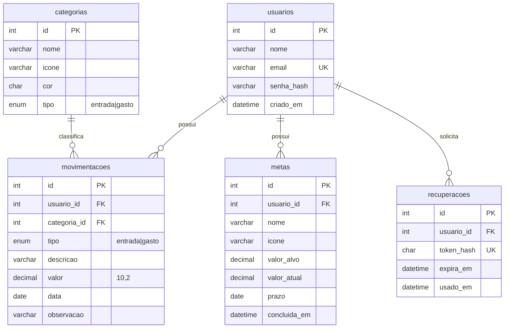

# Meu Dinheiro — Acervo técnico

Documento para quem vai manter ou evoluir o sistema. Versão descrita: 1.1.0.

## 1. Arquitetura

Aplicação PHP "clássica" em páginas, sem framework. Cada página é um script na raiz que carrega o núcleo, verifica a sessão, consulta o banco e devolve HTML. Ações que alteram dados (salvar/excluir) vão por `fetch` para endpoints JSON em `api/`.

```
Navegador ──HTML──▶ páginas (dashboard.php, gastos.php, ...)
    │                    │ usa
    │                    ▼
    │          includes/ (bootstrap, financeiro, layout, lista_mov, email)
    │                    │ PDO
    └──fetch/JSON──▶ api/ ──────────▶ MySQL (meu_dinheiro)
```

### Estrutura de pastas

| Caminho | Conteúdo |
|---|---|
| `index.php`, `login.php`, `cadastro.php`, `esqueci.php`, `redefinir.php`, `logout.php`, `instalar.php` | Páginas públicas |
| `dashboard.php`, `entradas.php`, `gastos.php`, `historico.php`, `metas.php`, `relatorios.php`, `configuracoes.php` | Páginas autenticadas |
| `exportar.php` | Exportação CSV e "PDF" |
| `api/movimentacao.php`, `api/meta.php` | Endpoints JSON (POST) |
| `includes/bootstrap.php` | Sessão, conexão PDO, helpers, CSRF, autenticação |
| `includes/financeiro.php` | Regras: totais, séries, alertas, conquistas, filtros |
| `includes/layout.php`, `modais.php`, `publico.php` | Cabeçalho/rodapé e modais compartilhados |
| `includes/lista_mov.php` | Lista paginada com filtros (usada em 3 telas) |
| `includes/email.php` | Cliente SMTP e utilidades de e-mail |
| `includes/versao.php` | `APP_VERSION` e `CHANGELOG` exibidos no sistema |
| `config/` | `config.php` (padrões), `config.local.php` (gerado), `mail.local.php` (opcional) |
| `sql/schema.sql` | Estrutura do banco e categorias iniciais |
| `assets/` | CSS e JS |

## 2. Modelo de dados



Decisões:
- `valor` em `DECIMAL(10,2)`, nunca `FLOAT`, para não acumular erro de arredondamento.
- Exclusão de usuário apaga em cascata movimentações, metas e pedidos de recuperação. Categorias não têm exclusão em cascata (`RESTRICT`), pois são compartilhadas.
- `tipo` fica na movimentação **e** na categoria; a API valida que a categoria escolhida é do mesmo tipo.
- Índices em `(usuario_id, data)` e `(usuario_id, tipo)` sustentam as consultas de painel e relatórios.
- `recuperacoes` também é criada sob demanda (`garantir_tabela_recuperacoes`) para bancos instalados na 1.0.0.

## 3. Fluxos principais

**Instalação.** `pdo()` falha ou não encontra a tabela `usuarios` → redireciona a `instalar.php` → valida campos → conecta sem banco → `CREATE DATABASE` → executa `schema.sql` (ignorando `CREATE DATABASE`/`USE` do arquivo) → grava `config.local.php` com `var_export`. A tela só abre se a instalação atual **não** funcionar.

**Login.** POST com CSRF → busca por e-mail → `password_verify` → `session_regenerate_id(true)` → grava `uid`. "Lembrar de mim" reemite o cookie de sessão com 30 dias. 5 falhas seguidas bloqueiam por 60 s (contador na sessão).

**Salvar movimentação.** Formulário → `fetch` POST `api/movimentacao.php` (`action=salvar`) → validações no servidor → INSERT/UPDATE com `WHERE usuario_id = ?` → mensagem em `$_SESSION['flash']` → `{ok:true}` → página recarrega e mostra a mensagem.

**Recuperar senha.** `esqueci.php` gera `random_bytes(32)`, guarda o SHA-256, envia o link com o token puro. `redefinir.php` recalcula o hash, exige `usado_em IS NULL` e `expira_em > NOW()`, troca a senha e marca **todos** os pedidos pendentes do usuário como usados, numa transação.

## 4. Endpoints

Todos exigem `POST`, sessão ativa e campo `csrf`. Respondem JSON: `{ok:true}` ou `{ok:false, erros:[...]}` com HTTP 401/403/404/422.

| Endpoint | `action` | Campos |
|---|---|---|
| `api/movimentacao.php` | `salvar` | `id?`, `tipo`, `descricao`, `valor`, `data`, `categoria_id`, `observacao?` |
| | `excluir` | `id` |
| `api/meta.php` | `salvar` | `id?`, `nome`, `icone`, `valor_alvo`, `prazo?` |
| | `guardar` / `retirar` | `id`, `valor` |
| | `excluir` | `id` |

Páginas com GET relevante: `exportar.php?formato=csv|pdf&tipo&categoria&mes&q&de&ate`, `relatorios.php?p=3|6|12`, `dashboard.php?mes=YYYY-MM`.

## 5. Segurança

| Ameaça | Como é tratada |
|---|---|
| SQL Injection | PDO com consultas preparadas e `EMULATE_PREPARES = false`. Únicos trechos com SQL montado (`$W`, `LIMIT`) usam só fragmentos fixos e inteiros convertidos. |
| Acesso a dados de outro usuário | Toda consulta e alteração filtra por `usuario_id` da sessão; o ID nunca vem do cliente. |
| XSS | Toda saída passa por `e()` (`htmlspecialchars`); no JS, textos entram por `textContent`. |
| CSRF | Token por sessão em formulários e requisições `fetch`; comparação com `hash_equals`. O logout também exige o token. |
| Senhas | `password_hash` (bcrypt/argon conforme o PHP) e `password_verify`. Política mínima de 8 caracteres com letras e números. |
| Fixação de sessão | `use_strict_mode`, `session_regenerate_id(true)` no login, cookie `HttpOnly` e `SameSite=Lax`. |
| Força bruta | 5 tentativas → 60 s. Recuperação de senha limitada a 3 pedidos por hora por usuário. |
| Enumeração de e-mails | A recuperação responde igual exista o e-mail ou não. |
| Token de recuperação | 256 bits aleatórios, só o hash no banco, 1 h de validade, uso único. |
| Injeção de fórmula em CSV | Células iniciadas em `= + - @` recebem apóstrofo. |
| Injeção de cabeçalho em e-mail | Quebras de linha removidas dos campos de cabeçalho; destinatário validado. |
| Host header poisoning | `url_base` pode ser fixado em `mail.local.php`; sem ele, o host é filtrado por expressão regular. |
| Exposição de configuração | `.htaccess` com `Require all denied` em `config/`, `includes/` e `sql/`; `config.local.php` e `mail.local.php` no `.gitignore`. |

**Limitações conhecidas:** o bloqueio de tentativas de login é por sessão (quem descarta o cookie reinicia a contagem); em produção convém HTTPS (para o cookie `Secure`), limite por IP e cabeçalhos como CSP.

## 6. Decisões de projeto

- **Sem framework e sem bibliotecas PHP:** o trabalho é acadêmico e o requisito são as tecnologias básicas; por isso até o cliente SMTP é próprio (`includes/email.php`, ~100 linhas, STARTTLS/SSL + AUTH LOGIN).
- **"PDF" por impressão:** gerar PDF de verdade exigiria biblioteca (Dompdf/TCPDF). A página de extrato tem CSS de impressão e o navegador salva como PDF, sem dependência nova.
- **Saldo acumulado, resto mensal:** o saldo é um estoque (tudo até o fim do mês), enquanto entradas e gastos são fluxos do mês. Evita "saldo zerado" a cada virada de mês.
- **Guardar em meta não mexe no saldo:** manter as metas como controle separado evita o usuário ter de lançar transferências; está descrito na documentação de uso.
- **Tema no navegador:** guardado em `localStorage` e aplicado por um script inline no `<head>` (antes da pintura) para não haver "piscada" branca. Todas as cores são variáveis CSS; o tema escuro só redefine os valores.
- **Mensagens após ação (flash) em sessão:** o `fetch` devolve JSON e a página recarrega; a mensagem sobrevive ao recarregamento pela sessão.
- **Instalador em vez de arquivo editado à mão:** reduz erros de configuração no primeiro uso.

## 7. Manutenção

**Nova versão:** atualize `APP_VERSION` e `CHANGELOG` em `includes/versao.php` e `CHANGELOG.md`.

**Nova categoria:** `INSERT INTO categorias (nome, icone, cor, tipo) VALUES (...)`. Aparece nos formulários e gráficos automaticamente.

**Alterar regra de alerta/nível:** `includes/financeiro.php` (`gerar_alertas`, `conquistas`).

**Alterar cores:** variáveis no topo de `assets/css/style.css` (bloco `:root` e `[data-bs-theme='dark']`).

**Dependências externas (CDN):** Bootstrap 5.3.3, Bootstrap Icons 1.11.3, Chart.js 4.4.1, Google Fonts (DM Sans, Fraunces, Caveat).

## 7.1 Teste manual (roteiro)

1. Instalar pela tela; criar conta com senha fraca (deve recusar) e depois válida.
2. Login com senha errada 5 vezes (deve bloquear 60 s).
3. Lançar entrada e gastos; conferir saldo = entradas − gastos no painel.
4. Enviar valor inválido, data futura e descrição vazia (a API deve recusar com mensagens).
5. Editar e excluir uma movimentação (confirmação obrigatória).
6. Criar meta, guardar até 100% (vai para concluídas) e retirar mais do que o guardado (deve recusar).
7. Com outro usuário, tentar abrir/alterar IDs do primeiro (deve responder "não encontrado").
8. Exportar CSV e abrir no Excel; abrir o PDF e imprimir.
9. Recuperar senha: link funciona uma vez; segundo uso mostra "Link inválido".
10. Alternar tema claro/escuro/automático e recarregar a página.
11. Reduzir a janela a 375 px: menu inferior aparece, tabelas rolam na horizontal.

Situação na versão 1.1.0: os itens 1, 3, 4, 8 (geração do CSV e da página de extrato), 9 e 10 (claro e escuro) foram executados durante o desenvolvimento. Os itens 2, 5, 6, 7 e 11 ainda precisam ser conferidos à mão.

## 8. Melhorias futuras sugeridas

- Orçamento mensal por categoria com alerta ao ultrapassar.
- Lançamentos recorrentes (assinaturas, mesada).
- PDF gerado no servidor (Dompdf) com gráfico embutido.
- Limite de login por IP e uso de HTTPS com cookie `Secure`.
- Testes automatizados das regras de `financeiro.php`.
